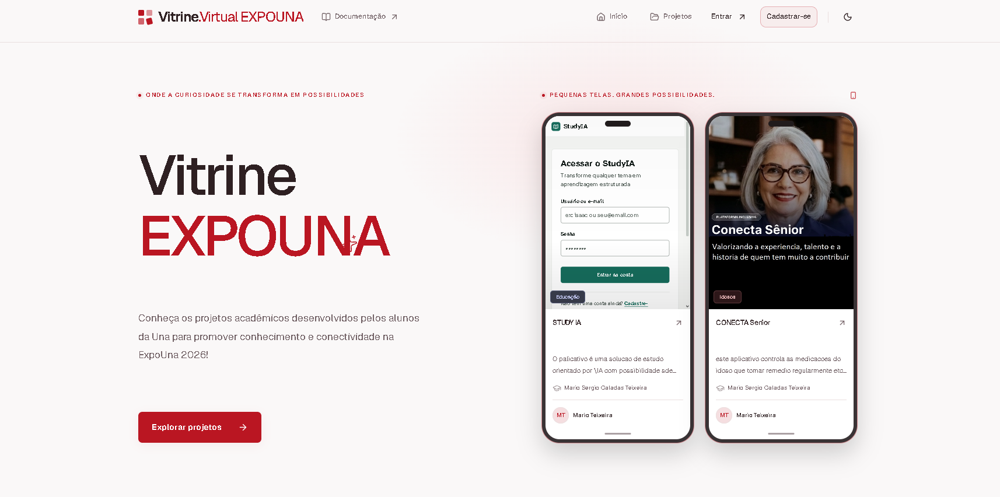

# Vitrine Virtual Expouna

<figure><figcaption></figcaption></figure>

A Plataforma de Exposição de Projetos Acadêmicos (Mostra+), é a solução web responsiva desenvolvida para transformar ideias universitárias em vitrines digitais acessíveis. O sistema conecta a comunidade externa aos trabalhos desenvolvidos pelos alunos da Una, integrando busca inteligente, filtros por área de conhecimento, páginas detalhadas de portfólio e fluxo institucional de validação entre alunos e professores.

## O Desafio

No ambiente acadêmico, especialmente durante eventos como a ExpoUna, os projetos de extensão, pesquisas científicas e trabalhos desenvolvidos pelos estudantes costumam ficar restritos ao espaço físico das apresentações ou dispersos em arquivos locais. Isso gera três desafios principais:

* &#x20;  Baixa visibilidade e alcance limitado: Visitantes externos, recrutadores e até  alunos de outros cursos têm dificuldade para conhecer e explorar os trabalhos produzidos fora do horário ou do local presencial do evento.
* Falta de um portfólio acadêmico centralizado: Não havia um repositório institucional unificado onde os estudantes pudessem registrar suas soluções com imagens, descrições técnicas, links e créditos da equipe.
* Processo manual de curadoria e validação: O acompanhamento e a aprovação dos trabalhos pelos professores orientadores careciam de um fluxo digital estruturado que garantisse a qualidade e a veracidade das publicações antes de irem ao ar.

## A solução

Para resolver esse cenário, foi desenvolvido o Mostra+ (Vitrine Virtual EXPOUNA) — uma plataforma web responsiva que funciona como um estande digital permanente e acessível para os projetos acadêmicos dos alunos da Una. Levando a democratização do acesso,  permitindo qualquer visitante pode navegar livremente pela vitrine, pesquisar iniciativas por palavras-chave e filtrar por áreas de conhecimento sem precisar criar uma conta.&#x20;

## Funcionamento

O Mostra+ funciona como um fluxo integrado que conecta estudantes, professores orientadores e visitantes externos em uma mesma vitrine digital. Para o público geral e visitantes, o acesso à página inicial é livre e dispensa qualquer tipo de cadastro: basta navegar pela vitrine, utilizar a barra de pesquisa ou aplicar filtros por área de conhecimento para explorar os projetos já aprovados, visualizando suas galerias de imagens, descrições técnicas, tecnologias empregadas, integrantes da equipe e links externos.

Já a publicação de novos trabalhos operam por meio de contas cadastradas, garantindo segurança e controle de acesso sem armazenar senhas localmente. Ao acessar o sistema, o aluno preenche o formulário de submissão com os dados do projeto (título, categoria, resumo de até 500 caracteres, até três imagens e links) e vincula o professor orientador responsável. O projeto entra inicialmente com o status _Pendente_ e aparece exclusivamente no painel de moderação do docente escolhido, que avalia o conteúdo e decide entre aprová-lo — liberando sua exibição imediata na vitrine pública — ou reprová-lo mediante uma justificativa obrigatória para que o estudante possa corrigir e reenviar o material.
